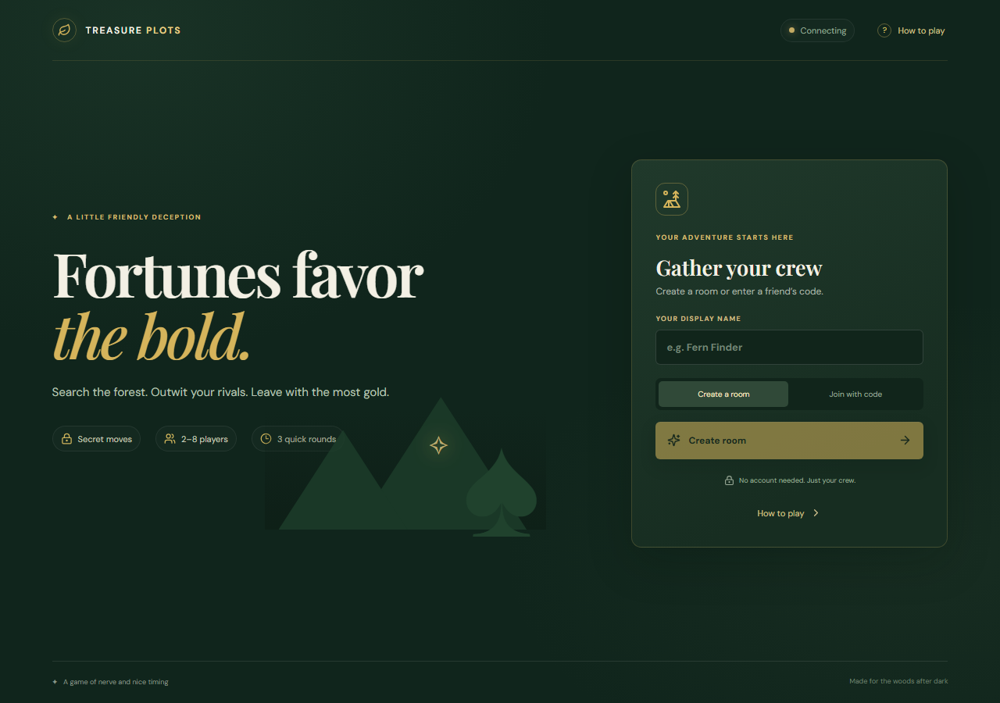
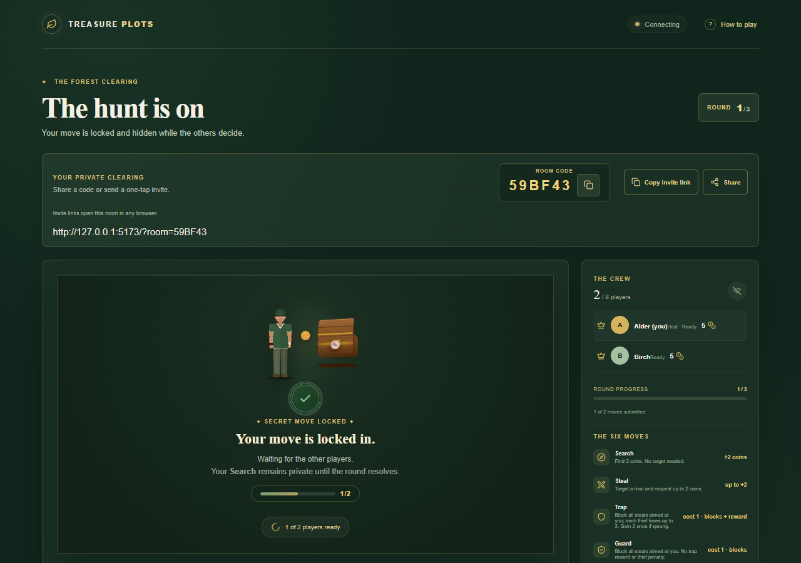
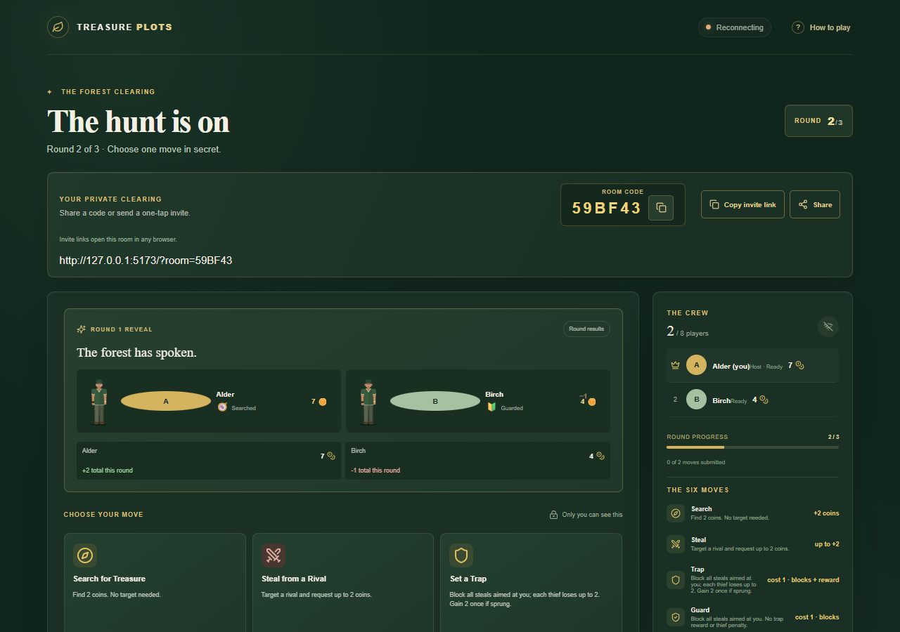
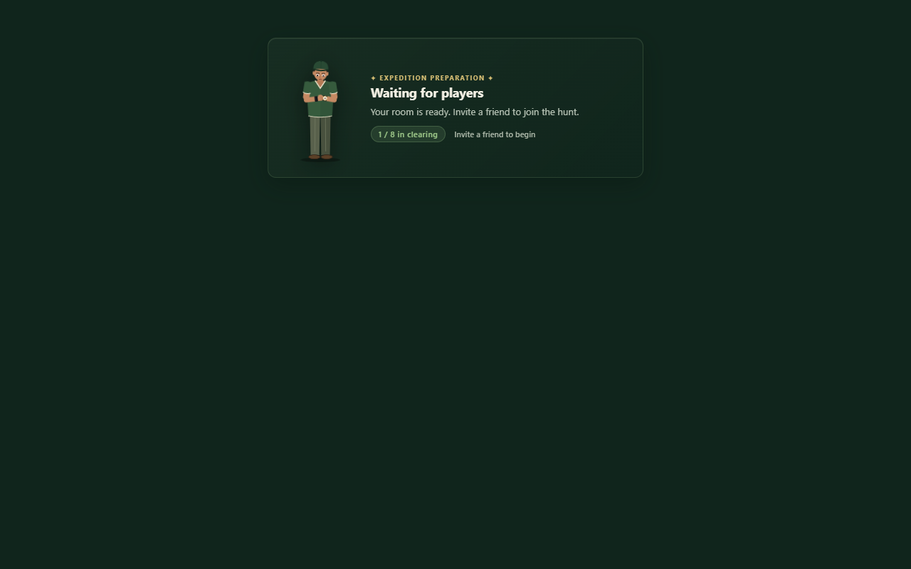
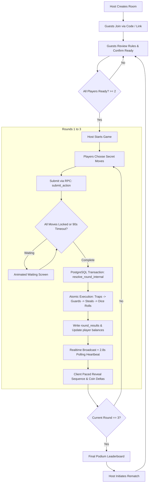

# Treasure Plots

[](https://react.dev/)
[](https://vitejs.dev/)
[](tests/)
[](https://developer.mozilla.org/en-US/docs/Web/JavaScript)
[](https://supabase.com/)
[](https://github.com/Kondareddy1209/Multiuser)
[](https://treasur-plots.netlify.app/)

> **Live Production Demo:** [https://treasur-plots.netlify.app/](https://treasur-plots.netlify.app/)<br />
> **Source Repository:** [https://github.com/Kondareddy1209/Multiuser](https://github.com/Kondareddy1209/Multiuser)

Treasure Plots is a real-time, browser-based multiplayer strategy and party game. Two to eight players gather in an anonymous clearing, start with five coins each, and compete across three rounds of simultaneous secret decisions.

Players can quietly search for treasure, target rivals with thefts, protect their stash with traps or shields, or venture into the deep woods on risky expeditions. All decisions remain shielded by database-level security until every player has committed, resolving simultaneously in a single, deterministic sequence.

*Note: This is an independent personal software project built to explore real-time multiplayer state synchronization, transactional database state machines, and responsive CSS/SVG animation systems.*

---

## Table of Contents

- [Visual Presentation](#visual-presentation)
  - [Screenshots](#screenshots)
- [Key Features](#key-features)
- [Game Rules & Mechanics](#game-rules--mechanics)
  - [Actions Overview](#actions-overview)
  - [Action Details](#action-details)
  - [Atomic Resolution Order](#atomic-resolution-order)
  - [Victory Condition](#victory-condition)
- [Architecture & Game Flow](#architecture--game-flow)
  - [Game Lifecycle](#game-lifecycle)
  - [System Flowchart](#system-flowchart)
- [Technical Challenges & Engineering Decisions](#technical-challenges--engineering-decisions)
- [Technology Stack](#technology-stack)
- [Project Structure](#project-structure)
- [Local Setup & Getting Started](#local-setup--getting-started)
  - [Prerequisites](#prerequisites)
  - [Installation](#installation)
  - [Environment Variables](#environment-variables)
  - [Database Configuration & Migrations](#database-configuration--migrations)
  - [Starting the Development Server](#starting-the-development-server)
- [Testing & Quality Verification](#testing--quality-verification)
  - [Running the Test Suite](#running-the-test-suite)
  - [Production Build Verification](#production-build-verification)
  - [Test Suite Breakdown](#test-suite-breakdown)
- [Deployment Configuration](#deployment-configuration)
- [Future Enhancements](#future-enhancements)
- [License & Author](#license--author)

---

## Visual Presentation

### Character & Atmosphere Concept
The game features a custom visual aesthetic inspired by forest expeditions. Below is the character artwork that serves as the visual reference for the in-game animated adventurer:

<p align="center">
  
</p>

### Screenshots

| Game entry — create a room or join with a code | Multiplayer waiting — move locked in |
|:---:|:---:|
|  |  |
| *Landing screen: "Gather your crew" with create/join flow* | *Move locked in; animated adventurer waits for rivals* |

| Round reveal and move selection | Expedition lobby waiting for players |
|:---:|:---:|
|  |  |
| *Round 1 results (Alder +2 · Birch −1) and move picker for Round 2* | *Pre-game lobby with watch-check animation* |

---

## Key Features

- **Anonymous Multiplayer Rooms:** Create private rooms with random 6-character codes or join instantly using direct URL invite links (`?room=CODE`) with native clipboard and device sharing support.
- **2 to 8 Player Capacity:** Seamlessly supports duels as well as party matches of up to eight players per room.
- **Player Readiness Verification:** Hosts are automatically marked ready upon room creation; joiners review game rules and confirm readiness before the host can launch the match.
- **Six Balanced Action Cards:** Choose between guaranteed gains (Search), targeted rivalry (Steal), counter-offenses (Trap), total defense (Guard), and calculated gambles (Dig Deep, Explore).
- **Simultaneous Secret Decisions:** Players lock in their moves independently. Submissions remain hidden by PostgreSQL Row Level Security (RLS) until all players submit or the disconnect window expires.
- **Deterministic Multi-Thief Allocation:** Proportional distribution algorithm with stable remainder assignment when multiple players attempt to steal from the same target simultaneously.
- **Resilient Reconnects & Rematches:** Submitted choices persist across page reloads. A 90-second grace window protects disconnected players before resolving without them. Hosts can trigger instant room rematches.
- **Articulated Waiting & Reveal Animations:** Custom inline SVG character featuring namespaced CSS keyframes, step-by-step reveal pacing, and full support for `prefers-reduced-motion`.

---

## Game Rules & Mechanics

Each player starts the match with **5 coins** and competes over **3 rounds**.

### Actions Overview

| Action | Cost | Base Gain | Requirements & Mechanics | Net Outcome |
| :--- | :---: | :---: | :--- | :---: |
| **Search** | `0` | `+2` | No target required. Safe baseline coin gain. | **+2 coins** |
| **Steal** | `0` | Up to `+2` | Must target a rival. Deducts up to 2 coins from target. Blocked by Trap and Guard. | **0 to +2 coins** |
| **Trap** | `1` | `0` | Blocks all incoming steals. Each thief loses up to 2 coins. Sprung trap awards setter +2 once. | **-1 coin** (unattacked)<br>**+1 coin** (sprung) |
| **Guard** | `1` | `0` | Blocks all incoming steals for the round. No thief penalty or counter bonus. | **-1 coin** |
| **Dig Deep** | `1` | `0` / `+4` | 50% chance to find treasure and gain 4 coins; otherwise forfeit the 1 coin cost. | **-1 coin** (fail)<br>**+3 coins** (success) |
| **Explore** | `1` | `+1` | Guarantees 1 coin back, with a 50% chance to discover an extra 2 coins. | **0 coins** (fail)<br>**+2 coins** (success) |

---

### Action Details

#### Search
- **Cost:** `0 coins`
- **Net:** `+2 coins`
- The foundational risk-free action. Grants two guaranteed coins without targeting any player or exposing yourself to counter-defenses.

#### Steal
- **Cost:** `0 coins`
- **Net:** `0 to +2 coins`
- Targets a selected rival to siphon up to two coins from their current balance.
- **Multi-Thief Allocation:** When multiple thieves target the same player:
  1. The transferable pool is capped at `min(target_balance, 2 * thief_count)`.
  2. Each thief receives `floor(pool / thief_count)`.
  3. Any remainder coins are distributed one by one based on deterministic ordering.
  4. Target balances are strictly protected from falling below zero.

#### Trap
- **Cost:** `1 coin` (requires at least 1 coin balance)
- **Net:** `-1 coin` if unattacked; `+1 coin` if sprung (`-1 cost + 2 bonus`)
- Sets a defensive counter-measure. Blocks all incoming steals aimed at the player for that round.
- **Attacker Penalty:** Each thief attempting to steal from a trapped player loses up to 2 coins (capped at their current balance).
- **Setter Bonus:** If one or more thieves attempt to steal, the setter earns a one-time +2 coin reward regardless of the number of attackers.

#### Guard
- **Cost:** `1 coin` (requires at least 1 coin balance)
- **Net:** `-1 coin`
- Raises a protective shield blocking all incoming steals for the round. Unlike Trap, Guard inflicts no penalty on attacking thieves and provides no counter bonus.

#### Dig Deep
- **Cost:** `1 coin` (requires at least 1 coin balance)
- **Net:** `-1 coin` on failure; `+3 coins` on success
- A high-stakes expedition. An authoritative server roll gives a 50% chance to unearth 4 coins (yielding a net profit of +3 coins after paying the cost).

#### Explore
- **Cost:** `1 coin` (requires at least 1 coin balance)
- **Net:** `0 coins` on failure; `+2 coins` on success
- A cautious survey of the woods. The player immediately recuperates their 1 coin entry cost, and a 50% server roll determines whether an additional 2 coins are found.

---

### Atomic Resolution Order

When all active players lock in their moves—or when the 90-second disconnect timeout expires—the round resolves atomically within a single database transaction (`resolve_round_internal`):

1. **Self-Contained Actions:** Deduct costs and credit baseline gains for `search`, `trap`, `guard`, `dig_deep`, and `explore`.
2. **Trap Counters & Penalties:** Sprung traps deduct penalties from attackers first and credit setter bonuses. Resolving penalties prior to steals ensures thieves cannot spend coins they have already forfeited.
3. **Guard Blocks:** Remaining steal attempts directed at guarded players are neutralized with zero coin transfer.
4. **Steal Distribution:** Unblocked thefts deduct coins from targets and allocate spoils to thieves according to the proportional split algorithm.
5. **Payload Persistence:** Round outcomes, event logs, and updated balances are written to `round_results`, advancing the game state.

---

### Victory Condition

After **Round 3**, the match concludes:
- The player with the highest coin count is declared the winner.
- If two or more players share the highest coin total, all tied leaders share the victory.
- The host can initiate a rematch, resetting rounds, coin balances (back to 5), and readiness states.

---

## Architecture & Game Flow

### Game Lifecycle

1. **Lobby Creation & Joining:** Host creates a room; joiners connect via code or link.
2. **Rules Confirmation & Readiness:** Host is ready by default; guests review field rules and click "Confirm Readiness".
3. **Game Start:** Host initiates the game once at least 2 active players are marked ready.
4. **Secret Action Submission:** Each player chooses their move privately. Submissions are written to Supabase with write-only RLS policies.
5. **Waiting Period:** Players wait while viewing an animated character checking his watch. A 90-second grace window handles any network disconnects.
6. **Authoritative Resolution:** The last submitting player triggers the `submit_action` RPC, which invokes `resolve_round_internal` inside a PostgreSQL transaction.
7. **Coordinated Reveal:** Clients receive the new `round_results` record via Realtime (or the 2.8s polling heartbeat) and play a step-by-step reveal sequence.
8. **Progression / Rematch:** Rounds advance until Round 3 concludes, displaying the final leaderboard and rematch option.

### System Flowchart



---

## Technical Challenges & Engineering Decisions

### 1. Authoritative Server State vs. Client Tampering
- **Challenge:** In peer-to-peer or client-authoritative games, clients can inspect network payloads to reveal rival choices before committing their own.
- **Solution:** Move submissions write directly to an `actions` table configured with Row Level Security (RLS) that prohibits client SELECT queries on unrevealed moves. All random calculations (Dig Deep and Explore outcomes) and coin transfers execute inside `SECURITY DEFINER` PostgreSQL functions. Clients never calculate or dictate coin totals.

### 2. Multi-Attacker Contention & Solvency
- **Challenge:** Multiple players can target the same rival with Steal actions in the same round. If two players attempt to steal 2 coins from a rival who only has 2 coins, simple subtraction creates negative balances or creates coins out of thin air.
- **Solution:** A deterministic proportional allocation algorithm (`splitSteal` / SQL equivalent) caps total theft at `min(target_balance, 2 * thief_count)`, divides the pool evenly, and allocates remainder coins based on stable deterministic hashing (`md5(player_id || round_no)`). Targets are mathematically guaranteed never to drop below zero.

### 3. Defense Precedence Ordering
- **Challenge:** If Player A steals from Player B (who set a Trap), Player A forfeits up to 2 coins. If Player A also stole from Player C, in what order should coins be debited?
- **Solution:** The database transaction strictly resolves defensive Trap penalties *before* calculating outgoing theft gains. This ensures attackers cannot use newly stolen funds to pay off trap penalties.

### 4. Dual-Sync Resilience (Realtime + Heartbeat Fallback)
- **Challenge:** WebSocket connections can experience silent disconnects, missed messages, or mobile sleep throttling during multiplayer waiting phases.
- **Solution:** The client pairs Supabase Realtime channel subscriptions (`postgres_changes` on `rooms`, `players`, and `round_results`) with an automated 2.8-second polling fallback heartbeat (`get_room` RPC). If a WebSocket packet drops, the polling loop catches the state change without user intervention.

### 5. Accessible Motion & Responsive SVG Rendering
- **Challenge:** Complex SVG character animations and stepped coin reveals can cause layout thrashing and trigger discomfort for users sensitive to motion.
- **Solution:** The waiting adventurer is rendered as an inline SVG with lightweight, namespaced CSS keyframes that execute only when active. The reveal sequence actively queries `prefers-reduced-motion`; when detected, keyframe animations and multi-step timing are bypassed, rendering final balances and outcomes instantly.

---

## Technology Stack

- **Client Framework:** [React 18.3.1](https://react.dev/)
- **Build Tool & Bundler:** [Vite 6.0.7](https://vitejs.dev/) with [@vitejs/plugin-react 4.3.4](https://github.com/vitejs/vite-plugin-react)
- **Language:** JavaScript (ESM, strict syntax)
- **Backend & Database:** [Supabase](https://supabase.com/) via [@supabase/supabase-js 2.57.0](https://github.com/supabase/supabase-js)
- **Database Engine:** PostgreSQL 15+ (PL/pgSQL transactional stored procedures, Row Level Security, composite unique keys, advisory locks)
- **Iconography:** [Lucide React 0.468.0](https://lucide.dev/)
- **Styling:** Vanilla CSS with design system custom properties, fluid typography, dark-mode glassmorphic palette, and responsive mobile layouts
- **Animation:** Namespaced CSS keyframes, inline SVG manipulation, and stepped JavaScript sequence controller (`src/revealSequence.js`)
- **Testing:** Node.js native test runner (`node:test`, `node:assert/strict`)
- **Hosting:** [Netlify](https://www.netlify.com/) static single-page application hosting

---

## Project Structure

```text
Multiuser/
├── .env.example                     # Environment variable template
├── .gitignore                       # Git ignore rules (credentials, build artifacts, test outputs)
├── index.html                       # SPA HTML entry point
├── netlify.toml                     # Netlify build configuration & SPA rewrites
├── package.json                     # Scripts and project dependencies
├── vite.config.js                   # Vite bundler configuration
├── public/
│   └── adventurer_waiting.jpg       # Concept artwork asset for character design
├── src/
│   ├── AnimationComponents.jsx      # Articulated SVG character, waiting component, reveal rows
│   ├── animations.css               # Namespaced CSS keyframes for character & reveal effects
│   ├── animations.js                # Round seen tracking & motion preference utilities
│   ├── gameRules.js                 # Action definitions, costs, multi-thief splits, winner evaluation
│   ├── main.jsx                     # Core application views (Home, Lobby, Game, Reveal, Final)
│   ├── readiness.js                 # Player readiness verification & readback validation
│   ├── revealSequence.js            # Paced round reveal step builder & delta calculation
│   ├── style.css                    # Design tokens, layout grid, typography, glassmorphism
│   └── supabaseDiagnostics.js          # Development error logging & sensitive data redaction
├── supabase/
│   └── migrations/
│       ├── 001_game.sql             # Base schema: rooms, players, actions, round_results, RPCs
│       ├── 002_multiplayer_actions_and_readiness.sql # 6 actions, readiness state, request idempotency
│       └── 003_reconcile_move_rpcs.sql # Composite keys reconciliation, steal model, trap ordering
└── tests/
    ├── animations.test.js           # Tests for seen round tracking, motion prefs, animation maps
    ├── gameRules.test.js            # Unit & invariant tests for game rules, steal splits, and RPC logic
    ├── readiness.test.js            # Tests for lobby readiness, UI states, and RPC safeguards
    ├── revealSequence.test.js       # Tests for reveal sequence step generation and pose mapping
    └── watchCheck.test.js           # Structural tests verifying SVG hierarchy and CSS keyframe scoping
```

---

## Local Setup & Getting Started

### Prerequisites

- [Node.js](https://nodejs.org/) v18.0.0 or higher
- [npm](https://www.npmjs.com/) (bundled with Node.js) or [pnpm](https://pnpm.io/)
- A free [Supabase](https://supabase.com/) project

### Installation

1. **Clone the repository:**
   ```bash
   git clone https://github.com/Kondareddy1209/Multiuser.git
   cd Multiuser
   ```

2. **Install dependencies:**
   ```bash
   npm install
   # or
   pnpm install
   ```

### Environment Variables

Copy the template file to create `.env.local`:

```bash
cp .env.example .env.local
```

Open `.env.local` and provide your Supabase project credentials:

```env
VITE_SUPABASE_URL=https://YOUR_PROJECT_ID.supabase.co
VITE_SUPABASE_ANON_KEY=YOUR_SUPABASE_ANON_PUBLISHABLE_KEY
```

> **Security Note:** Supply only the public **anon/publishable key**. Never expose your Supabase `service_role` secret in frontend configuration.

### Database Configuration & Migrations

1. In the [Supabase Dashboard](https://supabase.com/dashboard), select your project.
2. Navigate to **Authentication → Providers → Email / Password & Other Providers**.
3. Enable **Anonymous Sign-ins** (allows players to create and join rooms without an account).
4. Navigate to the **SQL Editor** and run the three migration scripts in order:
   - [`supabase/migrations/001_game.sql`](supabase/migrations/001_game.sql)
   - [`supabase/migrations/002_multiplayer_actions_and_readiness.sql`](supabase/migrations/002_multiplayer_actions_and_readiness.sql)
   - [`supabase/migrations/003_reconcile_move_rpcs.sql`](supabase/migrations/003_reconcile_move_rpcs.sql)

### Starting the Development Server

```bash
npm run dev
# or
pnpm dev
```

Open `http://localhost:5173` in your browser. To test multiplayer locally, open a second incognito window or alternate browser profile and join using the generated room code.

---

## Testing & Quality Verification

### Running the Test Suite

The test suite runs natively in Node.js without requiring a running database or external services:

```bash
npm test
# or
node --test
```

### Production Build Verification

To verify that the application compiles into an optimized production bundle:

```bash
npm run build
```

Preview the production build locally:

```bash
npm run preview
```

### Test Suite Breakdown

All **55 tests** execute synchronously and verify the following domains:

| Test File | Verified Invariants & Coverage |
| :--- | :--- |
| **`tests/gameRules.test.js`** | Action definitions, coin costs, net yields, steal split mathematics, remainder tiebreakers, low-balance defenses, trap penalties, guard protections, RPC parameter validation, database error 21000 handling, and winner evaluation. |
| **`tests/readiness.test.js`** | Host auto-readiness, guest review mandates, minimum 2-player start conditions, readiness readback verification, rematch participant resets, and sensitive data redaction in diagnostics. |
| **`tests/animations.test.js`** | Round-seen tracking to prevent animation replay, rematch state resets, `prefersReducedMotion` safety, particle scaling calculations, and result status categorization. |
| **`tests/revealSequence.test.js`** | Step-by-step reveal event construction, authoritative delta attribution, trap reward deduplication, character pose mappings, and timing budget limits. |
| **`tests/watchCheck.test.js`** | Inline SVG structure verification, keyframe namespacing (`tp-waiting-player-*`), active-state CSS scoping, reduced-motion overrides, and waiting message copy. |

*Note: The automated test suite covers client-side state models, game rules, math invariants, and contract boundaries offline. Live multiplayer network interactions and database RPC executions are verified through live browser sessions on the deployed environment.*

---

## Deployment Configuration

Treasure Plots is deployed as a static single-page application on Netlify:

- **Live URL:** [https://treasur-plots.netlify.app/](https://treasur-plots.netlify.app/)
- **Build Command:** `npm run build`
- **Publish Directory:** `dist`
- **Routing Rules:** Handled via [`netlify.toml`](netlify.toml) (`/*` rewritten to `/index.html` with HTTP 200 for client-side routing)

To deploy your own instance to Netlify:
1. Connect your GitHub fork to Netlify.
2. In **Site configuration → Environment variables**, add `VITE_SUPABASE_URL` and `VITE_SUPABASE_ANON_KEY`.
3. Trigger a production build.

---

## Future Enhancements

The following enhancements are planned for future iterations:

- **Ambient Audio & Sound Effects:** An optional audio toggle featuring atmospheric forest ambience, coin clinks on gain, and counter-defense sound effects.
- **Customizable Room Settings:** Host options for custom round counts (e.g., 5-round matches) and adjustable starting coin balances (e.g., 3 to 10 coins).
- **In-Game Reaction Emotes:** Quick emoji reactions in the lobby and round reveal screens to heighten party interaction without requiring full text chat.
- **Spectator Mode:** Allow additional players beyond the 8-player cap to watch round reveals in real time.

---

## License & Author

- **Author:** [Kondareddy](https://github.com/Kondareddy1209)
- **Project:** Personal Portfolio Project
- **License:** All rights reserved by the repository owner.
